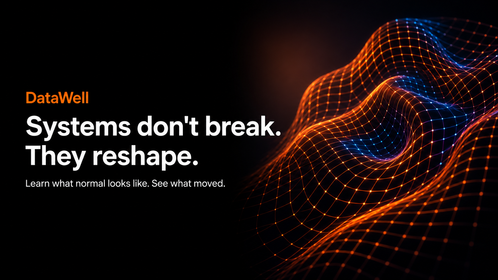

  

# DataWell

**A full-body MRI for your systems.**

Everything has a shape: how its parts normally move together. DataWell learns that shape from the data you already have, then shows you what moved when it changes, and how sure we are.

One product, two ways in.

## DataWell AI: for your agents

Agents change as they work. Models, prompts, tools, and plugins all shift, and the agent shifts with them. Agents don't break. They reshape.

DataWell AI learns what normal looks like for each of your agents and tells you when its shape moves, so you can decide whether it needs your attention. It works from metadata only. It never reads your prompts or replies.

## DataWell: for your systems

The same engine works on the systems your agents run on. Large AI infrastructure and critical, regulated systems change shape too.

DataWell maps how the parts of your system connect, then shows you what changed and where it first showed up.

## What you get

- **A picture of normal.** How your agents and systems usually behave together.
- **What moved.** What changed and the window it first showed up in.
- **How sure we are.** Every finding comes with a confidence level.
- **What we couldn't see.** Every report lists data that didn't arrive, so you know what a finding rests on.
- **Numbers you can check.** Every finding shows its data.

DataWell tells you what changed.

## Status

DataWell AI: early access, invite only. [Join the waitlist](https://datawellai.com).
DataWell: live in beta. [Request a demo](https://getdatawell.com).

## Where it comes from

DataWell is built by [Versai Labs](https://versailabs.com), an R&D lab built on one belief: trust in a decision comes from math and facts, not from persuasion.

DataWell was featured on the Cisco Outshift blog in [AGNTCY in action: How Orium and DataWell are expanding the Internet of Agents](https://outshift.cisco.com/blog/ai-ml/how-orium-and-datawell-expand-internet-of-agents).

[getdatawell.com](https://getdatawell.com) | [datawellai.com](https://datawellai.com) | [versailabs.com](https://versailabs.com)
